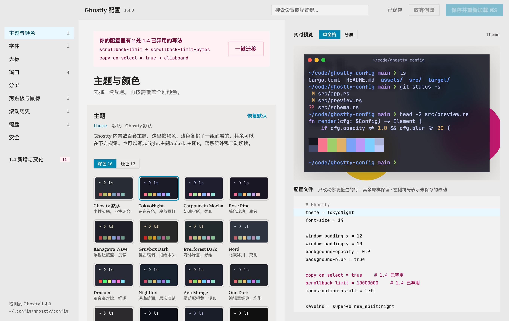
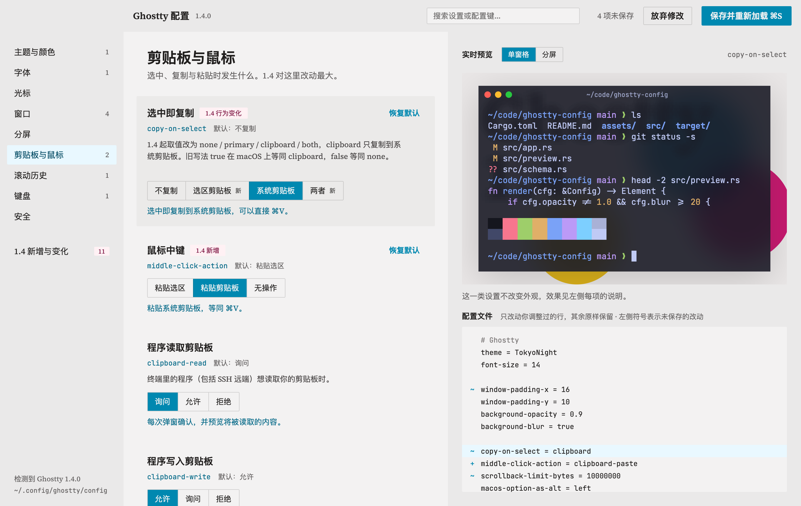
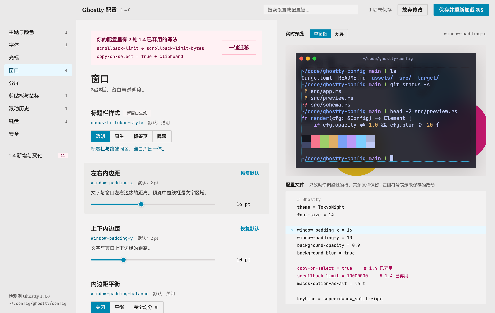
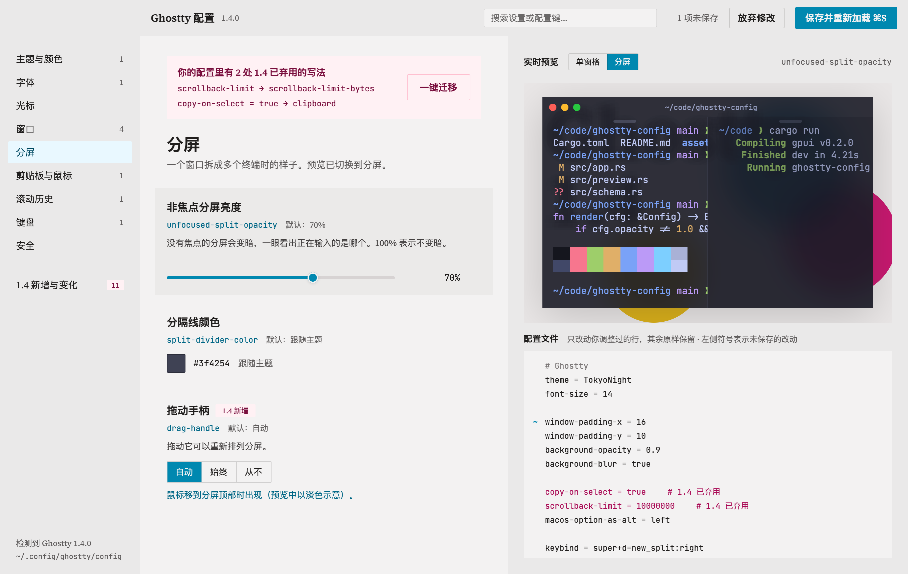

# Ghostty 配置

Ghostty 配置文件的可视化编辑器：左边挑选项，右边实时预览终端外观，下方同步显示将要写入的配置文件。用 Rust + [GPUI](https://github.com/zed-industries/zed/tree/main/crates/gpui) / [GPUI Kit](https://gpui-kit.com) 实现，界面按 Claude Design 里的「Ghostty 配置可视化工具」设计稿（Broadsheet 设计系统）实现；界面改动先改设计稿，再改代码。

选项、默认值和取值范围按 Ghostty 1.4.0 的 `ghostty +show-config --default --docs` 核对过。






## 功能

- **读写真实配置文件**：按 Ghostty 的查找顺序定位配置（`~/Library/Application Support/com.mitchellh.ghostty/config.ghostty` → `config`，再到 `$XDG_CONFIG_HOME/ghostty/config.ghostty` → `config`）。只改动你调过的那几行，注释、顺序、`keybind` 和所有本工具不认识的选项原样保留；恢复默认的项直接删掉那一行；新加的行放在同类选项旁边。配置文件是符号链接（dotfiles）时写入它指向的文件。
- **保存前校验**：先写到同目录的临时文件，交给 `ghostty +validate-config` 检查，通过才替换；Ghostty 拒绝时不动原文件，并显示错误。每次启动后的第一次保存会把原文件备份为 `config.bak-时间戳`。
- **保存即重新加载**：向正在运行的 Ghostty 发送 `SIGUSR2`。只在确认这个 Ghostty 会处理该信号时才发送（检查二进制里有没有对应的处理代码，1.4 有）；否则提示在 Ghostty 里按 ⌘ + Shift + , 手动重新加载。`background-opacity` 这类需要重启的项、`macos-titlebar-style` 这类只对新窗口生效的项会在提示里单独说明。
- **主题**：按深色 16 套、浅色 12 套精选常用的好看主题，每套附一句风格描述；其余 800 多套（含 `~/.config/ghostty/themes`）可搜索。
- **实时预览**：主题配色、字体与连字、字号行高、光标形状/颜色/闪烁、标题栏样式、内边距（悬停时显示文字区域虚线框）、背景透明与模糊/玻璃效果、分屏的分隔线、拖动手柄和非焦点变暗。
- **配置文件面板**：显示将要写入的完整文件，`~` 改动、`+` 新增、`−` 删除；悬停某项时自动滚到它在文件里的那一行。
- **1.4 弃用写法迁移**：识别 `scrollback-limit`（已改名为 `scrollback-limit-bytes`）、`copy-on-select = true/false` 和已移除的 `cursor-invert-fg-bg`，一键改成新写法。
- **覆盖的选项**：主题与颜色（含窗口外观、选中颜色）、字体（含字距）、光标（形状、闪烁、颜色、光标处文字颜色、高度、粗细）、窗口（标题栏、装饰、内边距、透明与模糊、新窗口尺寸、恢复窗口、关闭确认、色彩空间）、分屏、剪贴板与鼠标、滚动历史、键盘、Shell 与目录（Shell 集成及其功能、TERM、起始目录与继承）、安全。快捷键（`keybind`）暂不提供编辑，原样保留。
- **预览如实反映 Ghostty 的行为**：开启 Shell 集成的 cursor 功能时，提示符处的光标按 Ghostty 的做法显示为竖线，并给出说明。
- **外部修改**：编辑期间文件被别的程序改了，会自动重新读取，未保存的改动保留在上面；保存时如果发现文件变过，也会先合并再写。
- 控件表示不了的值（例如 `adjust-cell-height = 2` 这种像素写法、`background-blur = 12`）原样保留并注明，动了控件才替换。
- 字体列表标出 Ghostty 内置的 JetBrains Mono，以及 `ghostty +list-fonts` 里找不到的「未安装」字体；后备字体（第二个起的 `font-family`）保持不变。
- `palette = N=#…` 覆盖单独列为「调色板覆盖」，可以一键删除，让主题的调色板生效。

## 构建与运行

需要 macOS、Rust（edition 2024）、Xcode 命令行工具，以及已安装的 [Ghostty](https://ghostty.org)（1.4 起支持保存后自动重新加载）。

```sh
git clone https://github.com/BitBerry/ghostty-config
cd ghostty-config
```

```sh
cargo run                      # 开发运行
./script/bundle.sh             # 打包 target/Ghostty 配置.app
open "target/Ghostty 配置.app"
cargo test                     # 配置读写、取值换算的单元测试
```

快捷键：⌘S 保存并重新加载，⌘F 搜索设置，Esc 清空搜索，⌘Q 退出。菜单「显示」里可以隐藏配置键和说明文字。

环境变量：

| 变量 | 作用 |
|---|---|
| `GHOSTTY_CONFIG_FILE=路径` | 编辑指定的配置文件，而不是自动查找到的那个 |
| `GHOSTTY_CONFIG_CAT=font` | 启动时打开的分类（`theme` `font` `cursor` `window` `split` `clip` `scroll` `kbd` `sec` `new`） |
| `GHOSTTY_CONFIG_NO_RELOAD=1` | 保存后不通知 Ghostty 重新加载 |

### 离屏截图

`--features snapshot` 构建后可以把各个视图渲染成 PNG，用来检查界面（建议配合 `GHOSTTY_CONFIG_FILE` 指向一份副本）：

```sh
cargo build --features snapshot
GHOSTTY_CONFIG_FILE=/tmp/config GHOSTTY_CONFIG_SNAPSHOT=/tmp/snap \
GHOSTTY_CONFIG_SNAPSHOT_VIEWS="theme,window+focus=window-padding-x,split+set=background-opacity:0.8+set=background-blur:true" \
  ./target/debug/ghostty-config
```

视图写法：分类 id，后面可以接 `+focus=键`、`+set=键:值`（值写 `default` 表示恢复默认）、`+search=文字`、`+themes=文字`、`+migrate`、`+split`、`+save`。

## 代码结构

| 文件 | 内容 |
|---|---|
| `src/schema.rs` | 分类与选项表：控件类型、默认值、取值换算、说明文字 |
| `src/config.rs` | 配置文件按行解析；读出选项值；按最小改动生成新文件和每行的改动标记 |
| `src/ghostty.rs` | 定位 Ghostty 与配置文件、读取主题、校验、写入、SIGUSR2 重新加载 |
| `src/app.rs` | 主窗口状态、保存/放弃/外部修改合并、顶栏与侧栏 |
| `src/rows.rs` | 中间一栏：每个选项的行和控件（分段、滑块、取色、主题网格、字体列表） |
| `src/preview.rs` | 右侧终端预览与配置文件面板 |
| `src/backdrop.rs` | 预览背后的三色圆底图（含模糊、玻璃版本），GPUI 没有混合模式和背景滤镜，所以预先画成图片 |
| `src/theme.rs` `src/kit.rs` | Broadsheet 设计令牌与按钮、分段控件、标签等组件 |

## 已知限制

- 预览是示意：模糊/玻璃效果用预先模糊的底图模拟，「加粗渲染」用错位叠印模拟，字符宽度按 0.6 em 估算。
- 只管理设计稿里的这些选项；其他选项请直接编辑文件（工具会原样保留它们）。
- `config-file` 引入的其他配置文件不会被读取或修改。

## 许可

MIT，见 [LICENSE](LICENSE)。`assets/fonts/` 里打包的 Source Serif 4、JetBrains Mono、Fira Code、IBM Plex Mono、Source Code Pro 均以 SIL Open Font License 1.1 授权，各自的许可证在 `assets/fonts/licenses/`。
